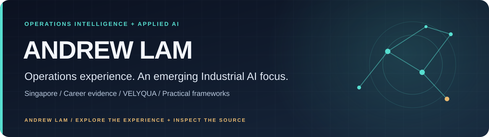

# Andrew Lam — Operations Intelligence & Applied AI

[**Open Authority Engine ↗**](https://authority-engine-app.vercel.app/) · [**Discuss this project**](https://authority-engine-app.vercel.app/contact?source=github) · [**Meet Andrew Lam**](https://authority-engine-app.vercel.app/about)

> Repository slug: `authority-engine`

## Start here

| You want to… | Go to |
| --- | --- |
| Explore the work | [Public portfolio](https://authority-engine-app.vercel.app/) and [evidence](https://authority-engine-app.vercel.app/evidence) |
| Understand the implementation | [Technical implementation](#technical-implementation) and [public claims](#standard-for-public-claims) |
| Contribute | [Contribution guide](CONTRIBUTING.md) and [security boundaries](SECURITY.md) |

[Report a bug](https://github.com/AndrewLamSingapore/authority-engine/issues) · [Ask a question](https://github.com/AndrewLamSingapore/authority-engine/discussions) · [Wiki](https://github.com/AndrewLamSingapore/authority-engine/wiki)

[Browse the project and source directory](https://github.com/AndrewLamSingapore/AndrewLamSingapore#selected-work) · [About Andrew](https://authority-engine-app.vercel.app/about)

## Connected work

[**Explore ORQEVIA**](https://authority-engine-app.vercel.app/orqevia) · [**Meet Andrew**](https://authority-engine-app.vercel.app/about) · [**Start a conversation**](https://authority-engine-app.vercel.app/contact?source=authority-engine&intent=collaboration)

ORQEVIA’s public walkthrough connects this project to Andrew’s wider work. Public navigation and enquiries do not merge accounts, data or runtime authority. Each product owns its source and domain records. Current operation requires its own deployment and runtime evidence; this README describes source capabilities.

## Operations experience. An emerging Industrial AI focus.

**Live:** https://authority-engine-app.vercel.app

This is Andrew Lam's public **PROVE layer**: a recruiter- and decision-maker-facing portfolio connecting more than 20 years of supply-chain and warehouse operations with analytics, data and AI.

The current direction has two connected tracks: build a stronger Singapore career in operations intelligence, AI-enabled operations, analytics or cloud support, while developing **VELYQUA** through customer discovery and a measurable pilot. Industrial AI and AI solutions roles are the direction of development, supported by existing operational experience and completed applied AI training.

VELYQUA currently provides manual aquarium water tests, observations and care history. AI-assisted monitoring, sensor performance and commercial outcomes require further development and validation. The portfolio distinguishes completed credentials, ongoing cloud training and future learning goals.

The refreshed public experience includes shared mobile navigation across all routes, light/dark portfolio themes, a VELYQUA feature, issuer-linked credentials, real operating evidence, interactive decision frameworks and career/pilot enquiry paths. Social previews and machine-readable profile content use the same positioning.

The repository slug is historical; the public identity is deliberately **Andrew Lam — Operations Intelligence** so the work is attributable to a person rather than confused with unrelated businesses using similar names.

> **What can the evidence actually support?**

## What this system proves

| Evidence | Scale | What it demonstrates |
|---|---:|---|
| **Live Container Operations Dashboard** | 391 anonymised jobs · 7 reporting periods · S$75,720 recorded revenue | Management visibility from real operating records |
| **Cold-Chain Risk Intelligence** | 1,800 AI-assisted synthetic records · 6 warehouse zones | Multi-signal early-warning analysis |
| **Supply Chain Control Tower** | AI-assisted synthetic concept | Cross-functional supplier, inventory and operating signal design |

Anonymised operational evidence and synthetic demonstrations are deliberately labelled differently.

## Evidence discipline

> **A polished interface does not upgrade the quality of the underlying evidence.**

| Level | Meaning |
|---|---|
| **E0** | Concept / hypothesis |
| **E1** | Synthetic or analytical demonstration |
| **E2** | Working prototype |
| **E3** | Real-world observations |
| **E4** | Repeated validation |
| **E5** | Production evidence at meaningful scale |

## Operating thesis

**OBSERVE → CONNECT → ANTICIPATE → DECIDE → ACT → LEARN**

## Public projects and source

| Repository | Purpose | Public destination | Source |
| --- | --- | --- | --- |
| **Andrew Lam · GitHub profile** | Profile and shared contracts | https://authority-engine-app.vercel.app/ | https://github.com/AndrewLamSingapore/AndrewLamSingapore |
| **Authority Engine** | Portfolio and evidence hub | https://authority-engine-app.vercel.app/ | https://github.com/AndrewLamSingapore/authority-engine |
| **VELYQUA · Application** | Aquarium software | https://velyqua.vercel.app/ | https://github.com/AndrewLamSingapore/velyqua |
| **VELYQUA · Product website** | Product introduction | https://velyqua-website.vercel.app/ | https://github.com/AndrewLamSingapore/velyqua-website |
| **THE PORTAL** | Discovery and research prototype | https://the-portal-ten.vercel.app/ | https://github.com/AndrewLamSingapore/the-portal |
| **ORQEVIA** | AI orchestration workspace | https://authority-engine-app.vercel.app/orqevia | https://github.com/AndrewLamSingapore/orqevia |
| **Living Worlds** | Persistent role-playing prototype | https://game-platform-wine-nine.vercel.app/ | https://github.com/AndrewLamSingapore/game-platform |
| **The Sky Tablet** | Interactive cultural storytelling | https://sky-tablet.vercel.app/ | https://github.com/AndrewLamSingapore/sky-tablet |

The Sky Tablet is an interactive exploration of Mesopotamian astronomy and cuneiform. Its software is publicly inspectable at E2; its simplified historical mappings remain educational rather than upgraded to scholarly evidence merely because the interface works.

## Technical implementation

- **React 19 + Vite** — frontend application
- **React Router v7** — routed case studies and public-build pages
- **Tailwind CSS** — responsive presentation system
- **Sanity** — published insight content
- **Formspree** — inquiry workflow
- **Vercel** — hosting and deployment
- **GitHub Actions** — lint + production build quality gate

### Public experience and code structure

- `/frameworks` provides practical decision models and an interactive framework finder; its content lives in `src/v2/data/frameworks.js`.
- `src/data/projects.js` is the shared public project registry. Navigation and enquiry links connect independent products without merging their accounts, data or runtime authority.
- `src/lib/insights.js` owns public Sanity reads, bounded request cancellation, article normalisation and controlled evidence wording. Browser routes use native fetch; write credentials and publication authority remain server-side.
- Article outages show a retry state. Missing articles return a real HTTP 404; upstream failures return HTTP 503. Direct article responses include escaped title, description and canonical metadata.
- Unused legacy homepage components and starter assets are removed; the active homepage, about and evidence routes use `src/v2`.
- `src/v2/refresh.css` provides the shared responsive presentation; existing dashboards, public walkthroughs, sound controls, article handling and private access boundaries retain their behavior.

Public profile review: 26 November 2026. `src/data/repository-profiles.json` lists all eight public repositories and their canonical destinations; the homepage and About page render that same directory. Owning sources reviewed: ORQEVIA `ced0853b9bd903ea6b2b82bde8a7aca7de73abcb`, VELYQUA `017393cd79f98ab9b9b5194643991b033389acf2`, its website `446b07420ba53ef9a65b6e132f1c4ea14e0005f7`, and THE PORTAL `b463131ba587a55e78b54923f9c4904224893af3`. These are source references, not private runtime acceptance claims.

Run `npm run lint`, `npm run check:server`, `npm run test:authority` and `npm run build` before release. The build generates all public sitemap routes and adds published article URLs when the content service is reachable; a failed content request produces an explicit static-route fallback. Browser acceptance and a deployment receipt remain separate checks from a successful local build.

## Portfolio architecture

| Layer | Purpose | Destination |
|---|---|---|
| **THINK** | Ideas and operating perspective | LinkedIn |
| **PROVE** | Evidence, case studies and analytical demonstrations | **This project** |
| **BUILD** | Code, products and experiments | GitHub |

## Standard for public claims

- Synthetic data is not presented as operational history.
- Anonymised operational evidence remains anonymised.
- A prototype is not described as validated science.
- A concept is not described as a shipped capability.
- Technology is not treated as evidence by itself.

See [`SECURITY.md`](SECURITY.md) for the repository's data and security boundaries.

**Operations × Data × AI → earlier signals → better decisions → measurable action.**

Copyright © 2026 Andrew Lam. All rights reserved.

## Status and evidence

> Current ORQEVIA source: [ORQEVIA-CURRENT-STATE.md](https://github.com/AndrewLamSingapore/orqevia/blob/main/ORQEVIA-CURRENT-STATE.md), reached through the portfolio pointer [STATUS.md](https://github.com/AndrewLamSingapore/orqevia/blob/main/STATUS.md). Each product owns its source, configuration, contracts and domain records. The [operational manifest](https://github.com/AndrewLamSingapore/orqevia/blob/main/governance/operational-manifest.json) is a dated historical reference. Source, CI, deployment and runtime acceptance are separate evidence.
